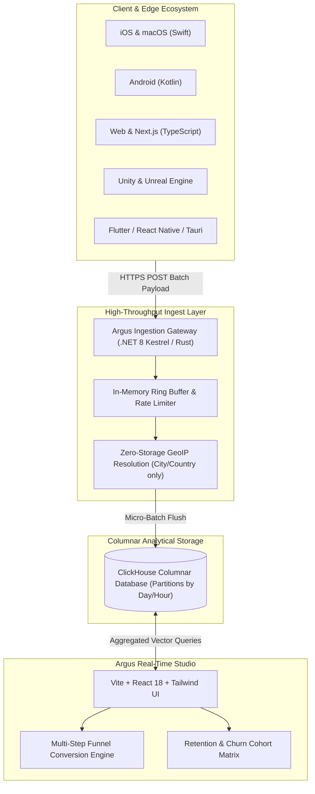

<p align="center">
  
</p>

<p align="center">
  <strong>High-Throughput Privacy-First Event Telemetry & Columnar Real-Time Analytics Engine</strong>
</p>

<p align="center">
  <a href="https://www.linkedin.com/in/akashjadon"></a>
  <a href="https://github.com/akashjadon04"></a>
  
  
  
</p>

---

## ⚡ Executive Summary

**Argus** (named after the hundred-eyed guardian of classical lore) is a ultra-fast, sovereign telemetry and event analytics engine. It provides comprehensive visibility into application metrics, user journeys, funnel conversions, and system events with **absolute privacy** — zero tracking cookies, zero persistent PII collection, and zero third-party cross-site profiling.

Backed by **ClickHouse**'s world-leading columnar analytics database and an asynchronous, non-blocking ingestion buffer in **Rust / .NET 8**, Argus can ingest tens of thousands of events per second on single-node hardware while serving complex aggregation queries in milliseconds.

---

## 🏛️ Ingestion & Analytics Architecture



---

## 💎 Core Technical Capabilities

| Capability | Specification | Value vs Legacy Analytics |
| :--- | :--- | :--- |
| **Sub-Millisecond Queries** | Columnar vector scans across billions of events | Crushes Mixpanel / Google Analytics 4 load times by eliminating row-based overhead. |
| **Strict Data Privacy** | 100% GDPR, CCPA, and PECR compliant by architecture | Requires no cookie consent banners; IP addresses are discarded immediately after in-memory country lookup. |
| **Multi-Platform SDKs** | Native libraries for 15+ modern platforms | Swift, Kotlin, Flutter, React Native, Unity, Unreal, Web, Node, Python, .NET. |
| **Self-Hosted Sovereignty** | Run on your own VPS, cloud VM, or bare metal | Your telemetry never leaves your infrastructure; zero vendor lock-in. |
| **Live Event Streams** | WebSockets & Server-Sent Events (SSE) | Real-time debugging of live application installs, sessions, and custom conversion goals. |

---

## 🚀 Quick Start (Docker & ClickHouse)

```yaml
version: '3.8'
services:
  clickhouse:
    image: clickhouse/clickhouse-server:latest
    ports:
      - "8123:8123"
      - "9000:9000"
    environment:
      - CLICKHOUSE_DB=argus
      - CLICKHOUSE_USER=argus
      - CLICKHOUSE_PASSWORD=argus_secret
    ulimits:
      nofile:
        soft: 262144
        hard: 262144

  argus:
    image: mcr.microsoft.com/dotnet/aspnet:8.0
    working_dir: /app
    volumes:
      - .:/app
    ports:
      - "3000:3000"
    environment:
      - ConnectionStrings__ClickHouse=Host=clickhouse;Port=8123;Username=argus;Password=argus_secret;Database=argus
      - AUTH_SECRET=argus-sovereign-super-secret-key-2026
    depends_on:
      - clickhouse
```

```bash
docker compose up -d
```

Navigate to `http://localhost:3000` to access the Argus Dashboard.

---

## 📡 Ingestion Code Example

### Sending Events via TypeScript / Web SDK

```typescript
import { init, trackEvent } from '@argus/analytics';

// Initialize with self-hosted Argus endpoint
init({
  appKey: 'A-SH-839201948',
  host: 'https://argus.yourdomain.com'
});

// Track high-impact workflow events
trackEvent('pipeline_executed', {
  duration_ms: 420,
  nodes_count: 12,
  status: 'success'
});
```

---

## 👨‍💻 Developer & Architect

<div align="center">
  <h3>Designed, Built & Maintained by <strong>Akash Jadon</strong></h3>
  <p><em>Autonomous Agent Architect | Distributed Systems Engineer | Platform Specialist</em></p>
  
  <a href="https://www.linkedin.com/in/akashjadon">
    
  </a>
  <a href="https://github.com/akashjadon04">
    
  </a>
</div>

---

## 📜 Sovereign Ownership & License

Decoupled and re-engineered as **Argus Telemetry Engine**. Maintained as a private, high-performance technology asset developed by **Akash Jadon**. All third-party telemetry, Crisp chat trackers, and external dependencies have been eliminated.\n